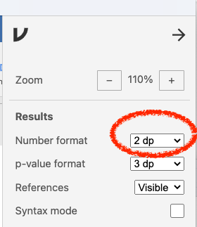

```{r setup, include = FALSE}
knitr::opts_chunk$set(echo = TRUE)
library(exams2forms)
library(vembedr)
```


## Purpose

In this exercise, you will learn to calculate descriptive statistics in jamovi. This assignment will explore trust in politicians and scientists. 

If you want to learn about this topic, see [The Politics of Climate Change](https://www.pewresearch.org/science/2016/10/04/the-politics-of-climate/)

(License available [here](https://osf.io/jsd6g/files/htgbx))

## Background Videos

Before starting this tutorial, watch the following videos to learn about calculating descriptive statistics.

### Descriptive Statistics (5 minutes 26 seconds)


```{r video, echo=FALSE} 
embed_youtube("srqNCux0ijY")

```


### Computing means (3 minutes 54 seconds)


```{r video 2, echo=FALSE} 
embed_youtube("-t1Q52QChoo")
```


### Written explanations

If you prefer written explanations of the steps involved, see Section 4 in [Learning Statistics with Jamovi](https://www.learnstatswithjamovi.com/).

## Set up jamovi

If you have not yet set up jamovi for the computer you are now using:

1. Using the website [jamovi.org](https://www.jamovi.org/), install jamovi onto your computer. Use the “solid” version that is recommended for most users.

2. Open jamovi.

3. In this course, you should report your results to 2 decimal places. Therefore, set the number format so you can see 2 decimal places. To do this,

    - Click the three dots on the top right of the Jamovi screen to change your preferences.
    
    - Look at the section for Results.

    - For Number format, use the drop-down menu to change decimal places to 2 dp.
    
::: columns
::: {.column width="50%"}
    
   
  
:::
::: {.column width="50%"}
  
:::
:::

## Data Set

1. If you do not have the dataset Climate Change Data.omv download it from the [Open Science Framework website](https://osf.io/jsd6g/)

2. Open this dataset in jamovi.

3. Save your jamovi file with a file name that includes your full name and the tutorial name. This will help you find it later when you want to do a similar analysis. 

Example: “Betty White PSY 422 Descriptive Statistics in Jamovi.omv”

## Descriptive Statistics for the Entire Sample

Using the Climate Change Trust Scale (Barchard, Hoffman, Okagawa, & Odents, 2021), we asked participants to tell us how much they trusted politicians and scientists, with response options 1 = None at all, 2 = A little, 3 = Moderate, 4 = A lot, 5 = A great deal. You will determine who participants trust more.

1. Under the Exploration menu, click **Descriptives**.


2. Calculate descriptive statistics for the variable CCTS_Politicians_Say (“How much do you trust what politicians say about climate change?”) and variable CCTS_Scientists_Say (“How much do you trust what scientists say about climate change?”).

3. Ask it to calculate three statistics that measure Central Tendency: Mean, Median, and Mode.

4. Ask it to calculate three statistics that measure Dispersion: Standard Deviation, Variance, and Range.

### Check your answers

::: {.callout-tip}

## Question 1

The mean for how much all participants trust what *politicians* say about climate change is `r forms_num((1.79), width = 7)`

:::


::: {.callout-tip}

## Question 2
The mean for how much all participants trust what *scientists* say about climate change is `r forms_num((3.95), width = 7)`

:::

::: {.callout-tip}

## Question 3

For which variable is there more variability – trust in what politicians say or trust in what scientists say? `r forms_schoice(c("CCTS_Politicians_Say", "CCTS_Scientists_Say"), c(FALSE, TRUE), display = "dropdown")`

:::

## Descriptive Statistics for Subsamples

Often researchers are interested in particular groups of participants. Here, we will calculate trust separately for people who identify as female, male, and non-binary.

1. To create another analysis without erasing the old one, click Exploration, then Descriptives.

2. Calculate descriptive statistics for the same two variables: **CCTS_Politicians_Say** (“How much do you trust what politicians say about climate change?”) and variable **CCTS_Scientists_Say** (“How much do you trust what scientists say about climate change?”). However, this time, split the results by **Gender**.

3. Calculate the same six statistics as last time: mean, median, mode, standard deviation, variance, and range.


::: {.callout-tip}

## Question 4

Who trusts politicians the most: people who identify as female, male, or non-binary? 

`r forms_schoice(c("Males", "Females", "Non-binary people"), c(TRUE, FALSE, FALSE), display = "dropdown")`

:::

::: {.callout-tip}

## Question 5

Who trusts scientists the most: people who identify as female, male, or non-binary?

`r forms_schoice(c("Males", "Females", "Non-binary people"), c(FALSE, FALSE, TRUE), display = "dropdown")`

:::

## Save your work

Don't forget to save your work. You can also export your jamovi file as a PDF if you would like to. To do this,

- Click the three horizontal bars on the top left of your Jamovi screen.

- Click Export.

- Enter a file name that includes your full name and the exercise name. 
  