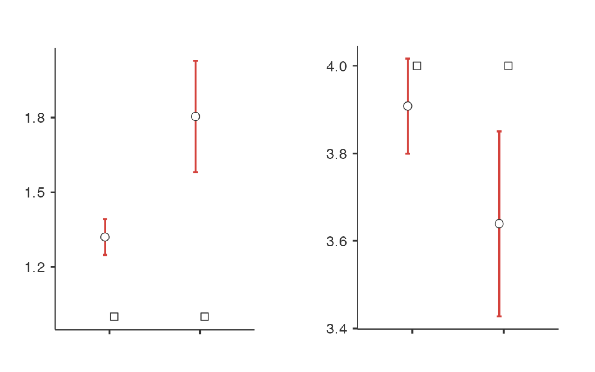

```{r setup, include = FALSE}
knitr::opts_chunk$set(echo = TRUE)
library(exams2forms)
library(vembedr)
```


## Purpose

This tutorial will show you how to conduct an independent-samples t-test (sometimes known as a two-sample t-test) and give you some tips on reporting results in APA format.

## Background Videos

You may already be familiar with how to calculate descriptive statistics from other tutorials; however, if you need a refresher, you could watch the following videos:

1. [Descriptive statistics](https://youtu.be/srqNCux0ijY) (5 minutes 26 seconds)

2. [Computing means](https://youtu.be/-t1Q52QChoo) (3 minutes 54 seconds)

Before starting this tutorial, watch the short video on the next slide to learn about independent samples t-tests.

If you prefer written explanations of the steps involved, see Section 11.3 in [Learning Statistics with Jamovi](https://www.learnstatswithjamovi.com/).

```{r video, echo=FALSE} 
embed_youtube("SM-DN9dpPd4")

```

## Set up Jamovi

If you have not yet done so, download Jamovi and set it up to show numbers to 2 decimal places and p-values to 3 decimal places. See previous tutorials if you don't know how to do this. 

## Data Set

1. Note: If you do not have the dataset Climate Change Data.omv download it from the [Open Science Framework](https://osf.io/jsd6g/).

2. Open this dataset in jamovi.

3. Save your jamovi file with a file name that includes your full name and the assignment name.

Example: “Dane Geros PSYC 422 Independent Samples in Jamovi.omv”

## Describe the Sample

Calculate descriptive statistics to describe the sample.

1. Calculate the mean and standard deviation of ages for all participants in the sample. That’s okay. Answer Question 1.

2. Use a new analysis to get descriptive information for the variable gender. Use Frequency Tables to obtain the number of female, male, and non-binary participants in the sample. Answer Question 2.

## Check your answers

::: {.callout-tip}

## Question 1

The mean participant age was `r forms_num((39.68), width = 6)` and the standard deviation was `r forms_num((11.69), width = 6)`

:::


::: {.callout-tip}

## Question 2

`r forms_num((212), width = 6)` participants said they were female, `r forms_num((285), width = 6)` said they were male, and `r forms_num((3), width = 6)` said they were non-binary.

:::


## Compare the Frequency of Recycling by Under 30 and 30+ Year Old Participants

The Psychological Responses to Climate Change (Clayton & Karazsia, 2020) asked respondents how often they recycle. In this section, we will compare the frequency of recycling reported by participants under 30 and participants 30+ years old. We will test the null hypothesis that the mean frequency of recycling is the same across age groups - $H_0: \mu(under 30) = \mu(30+)$ - vs. the alternative hypothesis that the means are different - $𝐻_1:\mu(under 30) \ne \mu(30+)$.

1. Conduct an independent-samples t-test.

2. Use the variables **PRCC18** (“I recycle.”) and group by **Age - Categorical** (“Age”).

3. Request the Student’s t test.

4. Under Additional Statistics, ask for the 95\% Confidence interval for the Mean Difference, Descriptives, and Descriptive plots.


## Report Your Results

In Psychology, we would summarize the hypothesis test results in a single sentence, as below. Fill in the blanks to report your result. 

Note that when summarizing an independent samples t-test, you need to start with a sentence that can be understood by someone who has never taken a statistics course: a sentence that summarizes what you found. This statement must say who you studied (e.g., people who were under 30 and at least 30), what variable(s) you measured (e.g., recycling), and what you concluded (e.g., participants 30+ recycled more). Then, in parentheses, give your statistical results: *test statistic* (degrees of freedom) = observed value, *p* = p-value, 95% confidence interval for the mean difference = [lower limit, upper limit]. Note that the test statistic (in our case *t*) and the symbol for p-value (*p*) are in italics.

::: {.callout-tip}

## Question 3

Compared to participants under 30, those who were at least 30 years old recycled `r forms_string(("more"), width = 6)` frequently,  *t*(`r forms_num((498), width = 4)`) = `r forms_num((2.16), width = 6)`, *p* =  `r forms_string((".032"), width = 6)`;  95% confidence interval for the mean difference = [`r forms_num((0.01), width = 6)`, `r forms_num((0.51), width = 6)`].

:::


## Compare the Extent to Which Concerns About Climate Change Interfere with Fun for Participants Under 30 and 30+ 

The Psychological Responses to Climate Change (Clayton & Karazsia, 2020) asked respondents how often climate change interferes with them having fun. In this section, we will compare younger and older participants on this variable. We will test the null hypothesis that the levels of interference are the same for participants who are under 30 and those who are at least 30 ($𝐻_0: \mu(under 30) = \mu(30+)$) vs. the alternative hypothesis that the means are different ($𝐻_1: \mu(under 30) \ne \mu(30+)$). 

1. Use the variables **PRCC9** (“My concerns about climate change make it hard for me to have fun with my family or friends”) and group by **Age - Categorical**.

2. Request the Student’s t test.

3. Under Additional Statistics, ask for the 95% Confidence interval for the Mean Difference, Descriptives, and Descriptive plots.

4. Consider how often people experienced concerns about climate change that interfered with having fun. Note that participants reported the frequency of this interference using the same response scale as above:

1 = Never  2 = Rarely  3 = Sometimes  4 = Often  5 = Almost always

5.  Use these results to answer the question about who experiences more concerns about climate change making it hard to have fun with family or friends, on average - individuals under 30 or 30+?

6. Use table showing the independent samples t-test for climate change making it hard to have fun to answer Question 4.

## Report Your Results

In Psychology, we would summarize the hypothesis test results in a single sentence, as below. Fill in the blanks to report your result. 


::: {.callout-tip}

## Question 4

Compared to individuals under 30, individuals over 30 reported `r forms_string(("lower"), width = 7)` levels of concern about climate change interfering with their fun, *t*(`r forms_num((498), width = 4)`) = (`r forms_num((-5.19), width = 4)`), *p* `r forms_string(("<.001"), width = 7)`; 95% confidence interval for the mean difference = [`r forms_num((-0.67), width = 4)`, `r forms_num((-0.3), width = 4)`].

:::


## Graphing your results 



::: {.callout-tip}

## Question 5

In the image above, the graph on the left represents the variable (variable name) `r forms_string(("PRCC9"), width = 7, usecase = FALSE)`, while the graph on the right represents the variable `r forms_string(("PRCC18"), width = 7, usecase = FALSE)`. The X axis label for both graphs should be `r forms_string(("Age - categorical"), usecase = FALSE, usespace = TRUE)`, and the X tick (category) labels should read `r forms_string(("30+"), width = 8, usecase = FALSE)` and `r forms_string(("Under 30"), width = 8, usecase = FALSE, usespace = TRUE)`.  

:::

## Save your work! 

Don't forget to save your work in a sensible place on your computer. Save it with your name and the name of the tutorial, so you can find it again when you need to do an independent samples t-test. 
