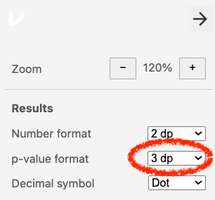

```{r setup, include = FALSE}
knitr::opts_chunk$set(echo = TRUE)
library(exams2forms)
library(vembedr)
```

## Purpose
This assignment will explore knowledge of climate change and how to reduce it. If you want to learn more about these topics, see [Ted Climate Change - Earth’s Giant Game of Tetris](https://ed.ted.com/lessons/climate-change-earth-s-giant-game-of-tetris-joss-fong) and/or [United Nations Ten Actions](https://www.un.org/en/actnow/ten-actions).


## Introductory Video
Before starting this tutorial, watch the short video below to learn about single sample t-tests in jamovi. If you prefer written explanations of the steps involved, see Section 11.2 in [Learning Statistics with Jamovi](https://www.learnstatswithjamovi.com/).


## One-sample t-test video (7 minutes, 7 seconds)

```{r t-test, echo=FALSE} 
embed_youtube("DrBT4ezYIL8")
```


## Set Up jamovi

If you have not yet set up jamovi for the computer you are now using:

1.  Using the website [jamovi.org](https://www.jamovi.org/), install jamovi onto your computer. Use the “solid” version that is recommended for most users.

2.  Open jamovi.

- In these exercises, you should report your results to 2 decimal places. Therefore, set the number format so you can see 2 decimal places. To do this:

  - Click the three dots on the top right of the jamovi screen to change your preferences.

  - Look at the section for Results.

  - For Number format, use the drop-down menu to change decimal places to 2 dp.
  
## Set Up p-values
 

3. In these exercises, you should report p-values to 3 decimal places. Therefore, set the p-value format so you can see 3 decimal places. To do this,

  a. Click on the three dots on the top right of the jamovi screen to change your preferences.

  b. Look at the section for Results.

  c. For p-value format, use the drop-down menu to make sure decimal places is set to 3 dp.
  

        
## Data Set

- If you do not have the dataset **Climate Change Data.omv**, download it from the [Open Science Framework](https://osf.io/jsd6g/) website.

- Open this dataset in jamovi.

-  Save your jamovi file with a file name that includes your full name and the exercise name.

Example: “Walter Mitty PSYC 422 Single Sample in Jamovi.omv”


# Performing the Single Sample t-test

When they answered the questions on the Climate Change Hope Scale (Li & Monroe, 2017), respondents indicated how much they agreed or disagree with the sentence “I know what to do to help solve problems caused by climate change.”  The response options were as follows: 

1 = Strongly disagree 

2 = Disagree 

3 = Slightly disagree 

4 = Neutral 

5 = Slightly agree 

6 = Agree 

7 = Strongly agree 

You will conduct a one-sample t-test to test the null hypothesis that participants agree that they know how to solve problems caused by climate change ($𝐻_0: \mu = 6$), versus the alternative that they do not agree ($𝐻_1: \mu \ne 6$). To do this, 

1. Click on T-Tests, and then choose One Sample T-Test.

2. Place the variable **CCHS8** (“I know what to do to help solve problems caused by climate change.”) in the section for Dependent Variables.

3. In the Tests section, make sure that “Student’s” is selected.

4.  In the Additional Statistics section, check the boxes for: 

  a. Mean Difference & Confidence interval (double check that this is set to 95\%) 
  b. Descriptives
  
## Performing the Single Sample t-test - test yourself!

5. In the test value box, replace “0” with “6” to indicate the hypothesis you are testing.

6. Use the output in your jamovi file to answer the questions below. Don't forget to report the t-value to 2dp and the p-value to 3dp. 

::: {.callout-tip}

## Question 1
The value of t obtained is  `r forms_num((-19.26), width = 7)`, and the value of p is  `r forms_string(("<.001"), width = 7)`

:::

::: {.callout-tip}
## Question 2 

The mean value on the item “I know what to do to help solve problems caused by climate change” is `r forms_num ((4.68), width = 7)` and the median is `r forms_num ((5.00), width = 7)`

:::

::: {.callout-tip}
## Question 3

Should you retain or reject the null hypothesis? 

`r forms_schoice(c("Retain", "Reject"), c(FALSE, TRUE), display = "dropdown")`
:::

## Confidence intervals - test yourself! 

7. In the jamovi output, look at the 95% Confidence Interval. This is **NOT** the confidence interval we want. Instead, it is the confidence interval for the **difference** between the test value (i.e., 6) and the population mean. To get the confidence interval for the population mean, **you need to add the test value (i.e., 6)** to the Lower and Upper limits given by jamovi.  Calculate the lower bound, and use this number as your answer to the first question.

8. Calculate the **upper bound** for the confidence interval for the population mean. Use this as your answer to the second question.

::: {.callout-tip}
## Question 4 

The lower bound of the confidence interval for the population mean is `r forms_num ((4.54), width = 7)` and the upper bound is `r forms_num ((4.81), width = 7)`

:::

## Save your work! 

Don't forget to save your work in a sensible place on your computer. Save it with your name and the name of the tutorial, so you can find it again when you need to do a single-sample t-test. 