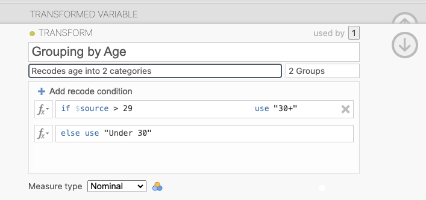
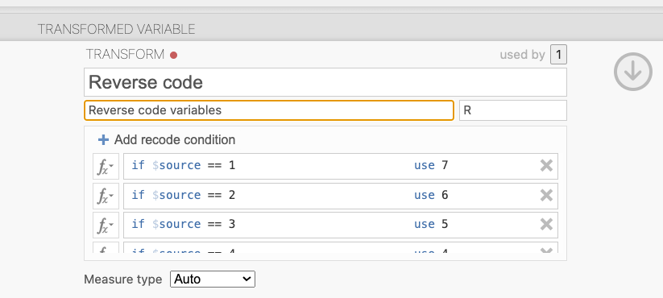
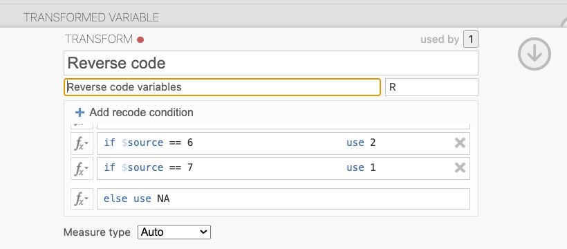
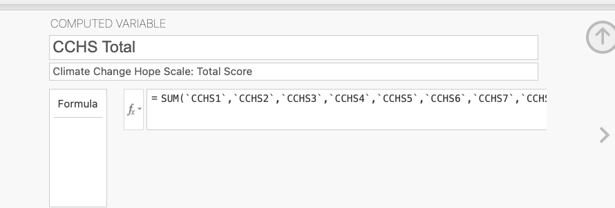
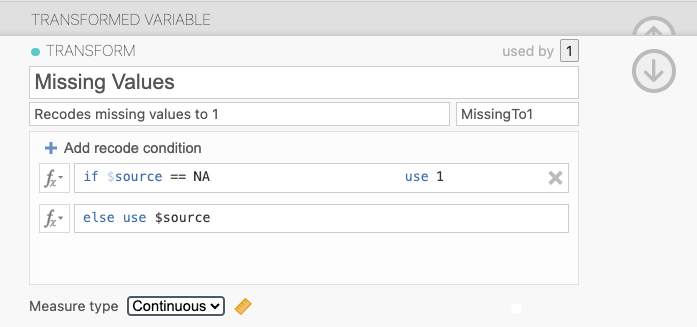
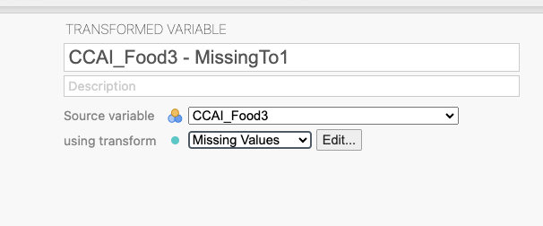

```{r setup, include = FALSE}
knitr::opts_chunk$set(echo = TRUE)
library(exams2forms)
library(vembedr)
```

## Purpose

The purpose of this exercise is to learn how recode (transform) data in jamovi. This exercise will explore how food choices can reduce climate change and feeling hopeful about climate change. If you want to learn more about these topics, see the following articles:

[Food and Climate Change](https://www.nytimes.com/interactive/2022/dining/climate-change-food-eating-habits.html) 

[Plant-based Diet can Fight Climate Change](https://www.bbc.com/news/science-environment-49238749) 

[How to Fight Climate Despair](https://www.vox.com/22595896/climate-change-fire-heat-wave-anxiety)

## Background Videos

You may already be familiar with how to split the file to obtain separate results for different groups from other assignments; however, if you need a refresher, you could watch the following video: [Descriptive statistics](https://youtu.be/srqNCux0ijY) (3 minutes 54 seconds).

Before starting this assignment, watch the three short videos below to learn how to recode data. If you prefer written explanations of the steps involved, see [Learning Statistics with Jamovi](https://youtu.be/10oomNrNe6w).

## Variable types and labels (6 minutes 9 seconds)

```{r video variableTypes, echo=FALSE}
embed_youtube("7tlvuYO76Ok")
```

## Computing z-scores (1 minute 56 seconds)

```{r video z-scores}
embed_youtube("EBvvkvqm9_o")
```

## Transforming scores to categories (3 minute 42 seconds)

```{r video transforms, echo=FALSE}
embed_youtube("moIsRlUZabw")
```

## Set Up Jamovi

If you have not yet set up jamovi for the computer you are now using:

1.  Using the website [jamovi.org](https://www.jamovi.org/), install jamovi onto your computer. Use the “solid” version that is recommended for most users.

2.  Open jamovi.

- In these exercises, you should report your results to 2 decimal places. Therefore, set the number format so you can see 2 decimal places. To do this:

  - Click the three dots on the top right of the jamovi screen to change your preferences.

  - Look at the section for Results.

  - For Number format, use the drop-down menu to change decimal places to 2 dp.

## Data Set

1.  If you do not have the dataset **Climate Change Data.omv**, download it from the [Open Science Framework](https://osf.io/jsd6g/) website.

2.  Open this dataset in jamovi.

3.  Save your jamovi file with a file name that includes your full name and the exercise name.

Example: “Mark Twain PSYC 422 Transforming Data in Jamovi.omv”

## Creating a grouping variable

When participants completed our study, they told us their age. We used that information to divide participants into two groups: under 30 and over 30. Here, you will learn how that is done. You will create a new transformed variable that assigns participants to two groups based upon their numeric answers for the variable **Age**. To do this:

1.  Insert a New Transformed Variable next to the current Age variable. To insert the variable, click the **Data** menu and click on the variable **Age**. Click **Add**. In the drop-down menu, using **Transformed Variable**, click Insert.

2.  Create a New Transform named “**Grouping by Age**”. To create this transform, click “**using transform**.” Click **Create New Transform**.

3.  In the description, explain what the transform does in more detail: “Recodes age into two categories”

4.  Under **variable suffix**, type “2 Groups”.

5.  Add recode conditions:

- `if $source > 29 use “30+”` 
- `else use “Under 30”`

6.  Under Measure type, select Nominal. Then close the New Transform dialogue.



## Create a grouping variable - check

7.  Compare the scores for the new variable you just created (Age – 2 Groups) with the scores for the variable that was created previously. The new variable (**Age – 2 Groups**) should be right next to the previous variable (**Age - Categorical**). Was each participant put into the same groups using the variables **Age – 2 Groups** and **Age - Categorical**?

::: callout-tip
## Question 1

The groupings for **Age - 2 Groups** and **Age - Categorical** are the same.

`r forms_schoice(c("True", "False"), c(TRUE, FALSE), display = "dropdown")`
:::

## Reverse-Coding an Item

Eleven of the variables in this data set were designed to measure *hope about climate change* (Li & Monroe, 2017). They are:

1.  I believe people will be able to solve problems caused by climate change. (**CCHS1**)

2.  I believe scientists will be able to find ways to solve problems caused by climate change. (**CCHS2**)

3.  Even when some people give up, I know there will be others who will continue to try to solve problems caused by climate change. (**CCHS3**)

4.  If everyone works together, we can solve problems caused by climate change. (**CCHS4**)

5.  I am willing to take actions to help solve problems caused by climate change. (**CCHS5**)

6.  I believe more people are willing to take actions to help solve problems caused by climate change.(**CCHS6**)

7.  I know that there are things that I can do to help solve problems caused by climate change. (**CCHS7**)

8.  I know what to do to help solve problems caused by climate change. (**CCHS8**)

9.  Climate change is beyond my control, so I won’t even bother trying to solve problems caused by climate change. (**CCHS9**)

10. Climate change is so complex we will not be able to solve problems that it causes. (**CCHS10**)

11. The actions I can take are too small to help solve problems caused by climate change. (**CCHS11**)

For most of these items, higher scores indicate more hope. However, for three of the variables, higher scores indicate less hope. These variables are **CCHS9** (“*Climate change is beyond my control, so I won’t even bother trying to solve problems caused by climate change.*”), **CCHS10** (“*Climate change is so complex we will not be able to solve problems that it causes.*”) and **CCHS11** (“*The actions I can take are too small to help solve problems caused by climate change.*”). We need to *reverse code* those three variables. To do this:

1.  Create a **New Transformed Variable** at the end of the data set.

2.  Create a **New Transform** called “**Reverse Coding**”. Use the suffix “R”. Provide an appropriate description for this transform.

3.  Add seven recode conditions:

- `if $source == 1 use 7`

- `if $source == 2 use 6`

- `if $source == 3 use 5`

- `if $source == 4 use 4`

- `if $source == 5 use 3`

- `if $source == 6 use 2`

- `if $source == 7 use 1`

4.  To indicate missing responses, use

- `else use NA`

5.  Under Measure type, select Continuous.

6.  Apply the Reverse Coding transform to the variables CCHS9, CCHS10 and CCHS11 to create variables **CCHS9 - R**, **CCHS10 - R**, and **CCHS11 - R**. Provide appropriate descriptions for the three new variables.







7.  Calculate the means for **CCHS9**, **CCHS10**, **CCHS11**, **CCHS9 - R**, **CCHS10 - R**, and **CCHS11 - R**.

8.  If you did your reverse coding correctly, your means should match those in the table below. 

9.  If the mean for **CCHS9**, **CCHS10** or **CCHS11** is incorrect, there’s something wrong with your data set. Download the data set from the OSF website again, and then re-do this assignment.

10. If the mean for **CCHS9 - R**, **CCHS10 - R** or **CCHS11 - R** is incorrect, there’s something wrong with your reverse coding. Edit your transformation and fix the error(s).

| Variable   | Mean |
|------------|------|
| CCHS9      | 2.96 |
| CCHS10     | 3.27 |
| CCHS11     | 3.77 |
| CCHS9 - R  | 5.04 |
| CCHS10 - R | 4.73 |
| CCHS11 - R | 4.23 |

: Means for original and reverse scored items

## Compute a Total Score for the Climate Change Hope Scale

Compute total scores for the Climate Change Hope Scale (Li & Monroe, 2017) using the recoded variables you created in the previous section. To do this: 

1. Create a **New Computed Variable** named “**CCHS**”.

2. Under description, type “Total score for Climate Change Hope Scale”.

3. In the functions drop-down menu, double-click the statistical function **SUM** to add it to your formula.

4. Double-click on the variable **CCHS1** to add it to your formula. Then type a comma.

5. Double-click on each of the remaining variables to add them one by one into the function. Separate them with commas. Your final function should read:

SUM (\`CCHS1\`, \`CCHS2\`, \`CCHS3\`, \`CCHS4\`, \`CCHS5\`, \`CCHS6\`, \`CCHS7\`, \`CCHS8\`,
 \`CCHS9 - R\`, \`CCHS10 - R\`, \`CCHS11 - R\`) 
 

 
 6. Double check that you have a total of 11 variables and that you used the recoded variables CCHS9 - R, CCHS10 - R and CCHS11 - R.

7. You should now have the total scores for your new variable CCHS. Calculate the mean for CCHS.

8. Use this mean to answer Question 2. 

::: {.callout-tip}

## Question 2
The mean for the CCHS is `r forms_num((53.92), width = 7)` (2dp). 

:::


9. Split the results by Age – Categorical.

10. Use these results to answer Question 3. 

::: {.callout-tip}

## Question 3

Who is more hopeful about climate change, participants who are under 30 or 30+?

`r forms_schoice(c("30+", "Under 30"), c(FALSE, TRUE), display = "dropdown")`

:::


## Recoding Missing Values

Jamovi ignores missing values when running analyses. This can lead to erroneous conclusions. For example, participants were asked how frequently they eat vegetarian/vegan meals. The possible response options were

1 = Less than once a year   

2 = Once a year 

3 = Several times a year 

4 = Once a month

5 = A couple times a month   

6 = Once a week   

7 = At least 3 times a week 

8 = At least 7 times a week  

9 = At least 14 times a week

Participants who did not answer this question probably eat vegetarian/vegan meals less than once a year. Therefore, we need to recode any missing values for the CCAI_Food3 variable to 1 (less than once a year) in order to get accurate means for this question. To do this: 

1. Create a new transform. Name it “Missing Values”.

2. Add an accurate description of what the transformation is doing (e.g., “Recodes system missing values to 1”.)

3. Use the variable suffix “MissingTo1”.

4. Add a recode condition that says

`if $source == NA use 1`

5. To keep the other values the same, use

`else use $source`

6. Under Measure type, select Continuous.

7. Use this new transform to recode the variable CCAI_Food3.

8. Add an appropriate description for this variable (e.g., “CCAI_Food3 with missing values recoded to 1”).






9. Calculate total number of responses (N), number of missing values, and mean for the original variable (**CCAI_Food3**) and for the transformed variable (e.g., **CCAI_Food3 – MissingTo1**).

10.  Split the above results by **Age – Categorical** to find out how often participants who are under 30 or 30+ eat vegetarian/vegan meals.

11. Use these results to answer the questions below. Who eats more vegetarian/vegan meals - under-30s or 30+ folks? 


::: {.callout-tip}

## Question 4
Once you recode missing values to 1, the mean for vegetarian/vegan meals eaten by under-30s is `r forms_num((4.54), width = 7)` (2dp). 

:::


::: {.callout-tip}

## Question 5
Once you recode missing values to 1, the mean for vegetarian/vegan meals eaten by over-30s is `r forms_num((4.26), width = 7)` (2dp). 

:::


## Check Your Work

1.  Your jamovi file should include the data set with the six new variables: **Age – 2 Groups**, **CCHS9 - R**, **CCHS10 - R**, **CCHS11 - R**, **CCHS**, and **CCAI_Food3 - MissingTo1**.

2.  Your jamovi output should include: 

  (a) means for **CCHS9**, **CCHS10**, **CCHS11**, **CCHS9 - R**, **CCHS10 - R**, and **CCHS11 – R**, 
  
  (b) the mean score on the Climate Change Hope Scale for participants who are under 30 and 30+, and
  
  (c) the mean frequency of vegetarian/vegan meals eaten for participants who are under 30 and 30+, both for the original variables and for the transformed variable.

3. Save your data file with an appropriate name so you can find it later. 